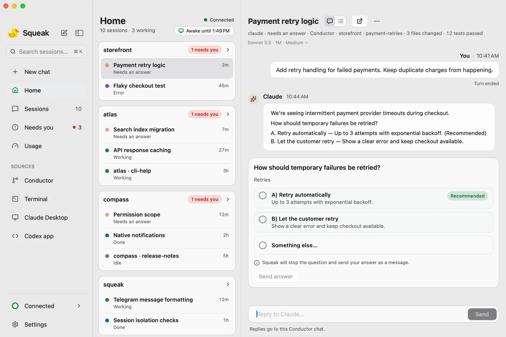

<p align="center">
  
</p>

# Your agents. In view.

**An attention inbox for your coding agents, with a duck.**

Running a few Conductor chats should not mean checking a few Conductor chats.
Squeak brings them into one native Mac app, puts the work that needs you first,
and lets you read, reply and get back to what you were doing. Step away from the
desk and keep the conversation going from your iPhone, a browser, Telegram or
Zoho Cliq.

Squeak is a free, open-source, independent companion to
[Conductor](https://conductor.build). It also watches local Claude Code and
Codex sessions, with replies supported in Apple's Terminal.

**[Download for Mac](https://github.com/Sibhimanyu/squeak/releases/latest)** ·
[Website](https://sibhimanyu.github.io/squeak/) ·
[Getting started](docs/getting-started.md) · [Uninstall](docs/uninstall.md) ·
[Report an issue](https://github.com/Sibhimanyu/squeak/issues)

<p align="center">
  
  <br><sub>Product preview with example sessions.</sub>
</p>

## Keep the work moving

- **See what needs you.** Questions, approvals, finished work, errors and active
  sessions have a place in one inbox. Read the agent's own messages and activity.
- **Answer in context.** Pick a lettered answer, respond to a question or plan,
  or write a message. Squeak checks delivery before calling a reply sent.
- **Start and steer Conductor chats.** Start a chat, queue a follow-up, or steer
  a running turn through the Conductor relay.
- **Stay close without staying at the desk.** Pair an iPhone or browser; add
  Telegram or Cliq cards when you want another way to hear about waiting work.
- **Reach it quickly.** A menu-bar duck, notifications and a configurable
  quick-message shortcut keep the inbox within reach.

Tool permission requests are shown as needing attention; granting those
permissions stays in Conductor. Question and plan responses have different
routes and limitations, explained in [Answering questions](docs/answering-questions.md).

## Install and set up your Mac

**Requirements:** an Apple-silicon Mac running **macOS 14 or later**, plus the
coding agents you already use. Conductor is required for Conductor chats; it is
optional for watching terminal agents. The download includes Node and Squeak's
background service, so normal installation needs no terminal or developer tools.
There is no Windows, Linux or Intel Mac app in this repository's release builds.

1. **Download the DMG and checksum** from
   [the latest release](https://github.com/Sibhimanyu/squeak/releases/latest).
   Verify the download if desired:

   ```bash
   # Run in the folder containing your downloaded DMG.
   shasum -a 256 Squeak-*.dmg
   ```

   Compare the result with `Squeak-<version>.dmg.sha256`.

2. **Drag Squeak to Applications and open it.** Builds are signed with a
   development certificate and **are not notarized**. On first launch, use
   right-click → Open; if macOS blocks it, use **System Settings → Privacy &
   Security → Open Anyway**. Look for the duck in the menu bar.
3. **Choose “Set up Squeak” in Welcome.** Follow **Settings → Setup** to install
   the background service and agent hooks. Hooks provide live state and waiting
   signals; installation preserves other tools' hook entries. It also adds
   removable instructions for agents to end questions with lettered choices.
4. **Connect Conductor if you use it.** In **Settings → Conductor**, run relay
   setup, allow the Keychain prompt, then **quit and reopen Conductor once**.
   Return to that page to check the connection. Setup backs up Conductor's
   database and offers an undo action.
5. **Enable the conveniences you want.** The Setup checklist links to
   notifications, the quick-message shortcut and live typing permissions.
   You can add remote channels later.

Reading Conductor chats works locally even before the service is installed.
Sending and the other session sources need the service. Updates are delivered
through Sparkle; use **Settings → About → Check for Updates** or adjust automatic
checks there.

### Which permissions do I need?

| Feature                           | Permission or setup                                                                                             |
| --------------------------------- | --------------------------------------------------------------------------------------------------------------- |
| macOS notifications               | Allow Squeak notifications when prompted.                                                                       |
| Double-tap quick-message shortcut | Allow **Squeak** in **Privacy & Security → Input Monitoring**. The alternate keyboard shortcuts do not need it. |
| Type into Conductor or Terminal   | Allow **Squeak Hands** in **Privacy & Security → Accessibility**. Hands is Squeak's typing helper.              |
| Reply to a Terminal agent         | Also allow Squeak Hands to control **Terminal** at the Automation prompt.                                       |
| Conductor relay                   | Allow its Keychain prompt and restart Conductor after setup.                                                    |

### Supported sessions

| Source on your Mac                         | Read and watch | Reply                                                               |
| ------------------------------------------ | -------------- | ------------------------------------------------------------------- |
| Conductor chats                            | Yes            | Yes; relay enables remote replies, new chats and steering.          |
| Claude Code or Codex in Apple's Terminal   | Yes            | Yes, at an eligible empty agent prompt, with the permissions above. |
| Other terminals, Claude Desktop and Cowork | Watch-only     | No.                                                                 |

Conductor's relay interface is undocumented and compatibility is checked by
version. A Conductor update can temporarily affect replies; see
[the integration notes](docs/conductor-local-feasibility.md).

## Take the inbox with you

Your Mac must be awake, online and running Squeak for remote actions. You can
use Squeak's keep-awake controls when stepping away.

### iPhone and web browser

In Squeak for Mac, open **Settings › iPhone** and choose **Set up…**. Squeak
can create and configure a Firebase project in your Google account, or use its
limited shared server; a by-hand route is also offered. Follow the
[remote channel guide](docs/remote-channel.md) for the Firebase rules, the
shared-server limits and configuration details.

1. Choose your client:
   - **Web:** open [Squeak for Web](https://squeak-mac.web.app/) in your browser;
     no app installation is needed.
   - **iPhone:** install through SideStore using the
     [iPhone installation page](https://squeak-5c9gvo.web.app/). The native app
     requires **iOS 18 or later** and is not distributed through the App Store.
2. In **Settings → iPhone** on the Mac, choose **Pair an iPhone**. Scan the QR
   code in the iPhone app or use the pairing link in Squeak for Web, then
   approve the device on your Mac.

The native iPhone app supports Face ID and a direct route on the same Wi-Fi;
web uses the cloud route. Free Apple ID / SideStore installs do not receive
native iPhone push notifications; Telegram and Cliq can provide alerts.

The current source also includes a guided Firebase setup and a limited shared
server option. These are not yet available in the latest public Mac release;
see [the remote channel guide](docs/remote-channel.md) for details and limits.

### Telegram

Create a bot with [@BotFather](https://t.me/BotFather) using `/newbot`. In
**Settings → Telegram**, enter its token and allow only the chats you want to
use. The bot sends attention cards with answer buttons and accepts replies.
Telegram uses its own bot service and does not require the iPhone channel.

### Zoho Cliq and phone calls

[Zoho Cliq setup](docs/cliq.md) covers the bot, owner restriction, webhook and
three Deluge handlers for two-way cards. It requires your own Firebase relay.

[Phone call setup](docs/voice.md) covers SIP/PBX calls that read a waiting
question and accept a keypad answer. Use a direct PBX connection or the Home
Assistant voice gateway. This is optional and needs additional infrastructure.

## Privacy and control

The Mac app reads local session data. Its background service listens on
`127.0.0.1:8477`; local control routes require a token. Conductor relay setup
changes Conductor's relay configuration and adds a Keychain item, and is
reversible from Settings.

The iPhone and web channel encrypt data end to end. The Mac accepts commands
only from approved device keys and checks signatures, freshness and replay
protection. You can disconnect devices from **Settings → iPhone**. Treat pairing
codes as secrets: a paired device can read sessions and send instructions to
your agents.

Telegram and Cliq use their providers' messaging services; they do not have the
phone channel's end-to-end encryption. Only connect channels you trust with
your agent conversations. The Mac app's message cache is encrypted on disk,
can be deleted in Settings, and expires after 14 days, with a 50 MB cap.

## Troubleshooting

| Symptom                                   | Next step                                                                                                                                        |
| ----------------------------------------- | ------------------------------------------------------------------------------------------------------------------------------------------------ |
| Reading works, but sending is unavailable | Check **Settings → Connections** and **About → Background service**; install or repair the service.                                              |
| “Relay isn't connected”                   | Open **Settings → Conductor**, check its status, and quit and reopen Conductor after setup. An unsupported version may leave the relay disabled. |
| Waiting states are missing or slow        | Run **Agent hooks** again in **Settings → Setup**.                                                                                               |
| Live typing fails                         | Check Squeak Hands' Accessibility grant and Terminal Automation permission. Other terminals are watch-only.                                      |
| A phone stops updating                    | Check that the Mac is awake and online, then check your connection in **Settings → iPhone**.                                                     |

For a bug report, use the app's **Report** button or
[GitHub Issues](https://github.com/Sibhimanyu/squeak/issues).
**Settings → About → Copy diagnostics** provides a redacted connection report.
The [getting-started guide](docs/getting-started.md) has more detail.

## Build and contribute

For daemon development, use **Node.js 22 or later**, npm and a native build
toolchain for `better-sqlite3` (on macOS, Xcode Command Line Tools). The native
Mac app additionally needs a Swift 6 toolchain. iPhone builds need Xcode and
XcodeGen; see [`ios/project.yml`](ios/project.yml) and
[`ios/scripts/release.sh`](ios/scripts/release.sh).

```bash
git clone https://github.com/Sibhimanyu/squeak.git
cd squeak
npm ci
npm run build
node dist/squeak/cli.js help
npm run ci
```

Run the daemon in the foreground with `node dist/squeak/cli.js start`. Stop an
existing Squeak service first so both processes do not compete for the same
port. Native development and packaging are described in
[`macos/README.md`](macos/README.md); the marketing site has its own
[`website/README.md`](website/README.md).

Useful CLI commands from the repository root:

```bash
node dist/squeak/cli.js config-path      # locate the .env file
node dist/squeak/cli.js init             # create a template without prompts
node dist/squeak/cli.js setup            # interactive Telegram configuration
node dist/squeak/cli.js hooks-status
node dist/squeak/cli.js install-hooks
node dist/squeak/cli.js uninstall-hooks
```

Configuration and secrets normally live in
`~/Library/Application Support/squeak/`; `SQUEAK_ENV_PATH` overrides the `.env`
path. Local Mac development tests:

```bash
(cd macos && swift test)
(cd ios/SqueakCore && swift test)
```

Read [`CLAUDE.md`](CLAUDE.md) for engineering context and [`DESIGN.md`](DESIGN.md)
for the shared design system. Additional guides cover
[the web client](docs/web-app.md), [questions and plans](docs/answering-questions.md)
and [RasanAI workflow integration](docs/rasanai-plugin.md).

## License

[Apache-2.0](LICENSE), with attribution in [NOTICE](NOTICE).
